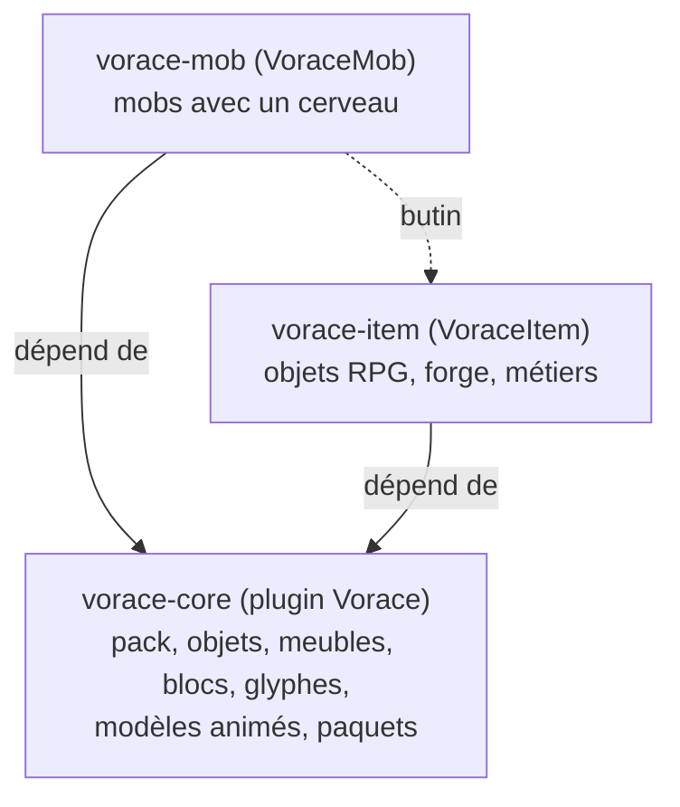

# VoracePlugin

Des plugins **libres et gratuits** pour serveurs Paper (Minecraft 1.21 à 26.x), pour tout faire sans plugin payant :
ce que font Nexo, ItemsAdder, ModelEngine, ProtocolLib, MythicMobs et MMOItems, en plus simple, en français, et
réglable avec des menus.


## Les trois plugins

| Plugin | Dépôt | Rôle | État |
|---|---|---|---|
| **Vorace** | [vorace-core](https://github.com/VoracePlugin/vorace-core) | Le socle : pack de ressources, objets, meubles, blocs, glyphes, modèles 3D animés, couche paquets, conversion depuis Nexo, Oraxen, ItemsAdder et ModelEngine | 1.2.0 |
| **VoraceMob** | [vorace-mob](https://github.com/VoracePlugin/vorace-mob) | Des mobs qui vivent : cerveau, besoins, troupeaux, laisse, zones, points d'apparition, oiseaux et papillons, décors vivants | 1.1.0 |
| **VoraceItem** | [vorace-item](https://github.com/VoracePlugin/vorace-item) | Les objets RPG : stats, rareté, armes modulaires, forge, métiers | en préparation |



- **vorace-core** marche seul. C'est lui qui fabrique et envoie le pack, et qui affiche les modèles animés.
- **vorace-mob** et **vorace-item** ont besoin de vorace-core (`depend: [Vorace]`). On n'installe que ce dont on a besoin.
- Les deux pourront travailler ensemble : les monstres de vorace-mob lâcheront les objets de vorace-item.

## Installer

1. Mets `Vorace-x.y.z.jar` dans `plugins/`, puis ceux dont tu as besoin : `VoraceMob-x.y.z.jar`, `VoraceItem-x.y.z.jar`.
2. Redémarre : chaque plugin crée ses exemples (`plugins/Vorace`, `plugins/VoraceMob`, `plugins/VoraceItem`).
3. `/vorace` ouvre les menus ; `/vmob` gère les mobs.

Les `.jar` sont dans les **Releases** de chaque dépôt, ou dans les **Actions** (« Compilation ») pour la dernière version.

## Pour les développeurs

Chaque plugin s'utilise comme dépendance avec [JitPack](https://jitpack.io) :

```kotlin
repositories { maven("https://jitpack.io") }
dependencies {
    compileOnly("com.github.VoracePlugin:vorace-core:<version>")
    compileOnly("com.github.VoracePlugin:vorace-mob:<version>")
}
```

- API : `fr.vorace.api.VoraceAPI` (vorace-core) et `fr.vorace.mobs.VoraceMobAPI` (vorace-mob), avec leurs événements.
- Chaque dépôt a sa compilation automatique et ses essais sur un vrai serveur Paper avec un faux joueur.
- Le détail de chaque version est dans le `CHANGELOG.md` de chaque dépôt.

## Feuille de route

- **vorace-core** : armes modulaires assemblées dans le pack, données propres à chaque exemplaire d'objet, temps de
  recharge visible sur un objet (pour vorace-item).
- **vorace-mob** : compétences de monstres (attaques en zone, projectiles, invocations, déclencheurs à X % de vie),
  butin, menace par joueur, boss avec phases et barre de vie, apparitions par vagues.
- **vorace-item** : stats et rareté, armes modulaires, forge et métiers, compétences d'armes.

## Histoire

Vorace est né d'un seul plugin. En novembre 2026, sa version 1.1 a ajouté des modèles animés plus fluides et un
système de mobs complet pour le serveur Babel (ville d'Orario, 2 185 animaux). Pour garder le socle léger, les mobs
sont sortis dans leur propre plugin et le projet est devenu l'organisation VoracePlugin.

Licence : MIT pour tous les plugins.
